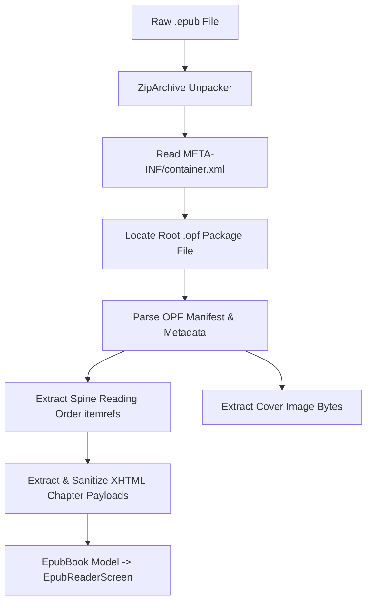

# 🛠️ ReadSanctuary — Developer & Architecture Manual

> **Comprehensive technical architecture, engineering specifications, database design, algorithms, and contribution guidelines for ReadSanctuary.**

[](https://flutter.dev)
[](https://dart.dev)
[](https://github.com)
[%20v3-blue)](https://drift.simonbinder.eu)
[](https://riverpod.dev)
[](test/)
[](README.md)

---

## 🧭 Navigation
- Looking for user instructions, features, and how to use the app? 👉 Check out the [**User Guide (README.md)**](README.md).
- Developing, modifying, or testing ReadSanctuary? You are in the right place!

---

## Table of Contents
1. [Architecture & Design Principles](#-architecture--design-principles)
2. [Codebase Directory Structure](#-codebase-directory-structure)
3. [Database Architecture & Drift Specifications](#-database-architecture--drift-specifications)
   - [Schema Definition (Schema V3)](#schema-definition-schema-v3)
   - [Architectural Schema Decisions](#architectural-schema-decisions)
   - [Data Access Objects (DAOs) & Reactive Streams](#data-access-objects-daos--reactive-streams)
4. [Deep Dives: Key Systems & Algorithms](#-deep-dives-key-systems--algorithms)
   - [1. Procedural 2.5D Spine Engine & Lighting Shaders](#1-procedural-25d-spine-engine--lighting-shaders)
   - [2. In-App Pure-Dart EPUB Reader Architecture](#2-in-app-pure-dart-epub-reader-architecture)
   - [3. Granular Sub-Ratings Engine & Auto-Average](#3-granular-sub-ratings-engine--auto-average)
   - [4. Android Home Screen Widget & Platform Channels](#4-android-home-screen-widget--platform-channels)
   - [5. Dual-API Book Lookup & Gutenberg Free eBooks](#5-dual-api-book-lookup--gutenberg-free-ebooks)
   - [6. Clean-Room CSV Import & Export Engine](#6-clean-room-csv-import--export-engine)
   - [7. Image Storage & Relative Path Contract](#7-image-storage--relative-path-contract)
   - [8. Focus Reading Timer & OS-Kill Resilience](#8-focus-reading-timer--os-kill-resilience)
   - [9. Daily Streak & Habit Engine](#9-daily-streak--habit-engine)
   - [10. Backup Archiver & Cloud Sync Architecture](#10-backup-archiver--cloud-sync-architecture)
   - [11. RevenueCat & Offline Gift Code Entitlement Engine](#11-revenuecat--offline-gift-code-entitlement-engine)
5. [Local Development & Environment Setup](#-local-development--environment-setup)
   - [Prerequisites](#prerequisites)
   - [Clone & Installation](#clone--installation)
   - [Code Generation](#code-generation)
   - [Running the App](#running-the-app)
6. [Testing & Quality Assurance](#-testing--quality-assurance)
   - [Test Directory Layout](#test-directory-layout)
   - [Executing Tests](#executing-tests)
   - [Static Analysis & Linting](#static-analysis--linting)
7. [Licensing & Clean-Room Compliance](#-licensing--clean-room-compliance)
8. [Contribution Guidelines & Coding Standards](#-contribution-guidelines--coding-standards)

---

## 🏗️ Architecture & Design Principles

ReadSanctuary is architected as an **Offline-First, Local-First, Clean Architecture** mobile application using Flutter and Dart.

```mermaid
flowchart TD
    subgraph Presentation ["Presentation Layer (Flutter + Riverpod)"]
        UI[Screens & Widgets]
        VM[Riverpod Providers / StateNotifiers]
        EPUB[In-App EPUB Reader]
        WidgetSync[Home Widget Provider]
    end

    subgraph Domain ["Domain Layer"]
        M[Domain Models & Value Objects]
    end

    subgraph Data ["Data Layer"]
        DAOs[Drift DAOs & SQLite Tables (v3)]
        EpubService[Pure Dart EPUB Parser]
        RemoteServices[Book Lookup & Gutenberg APIs]
        StorageHelper[Image Storage & Path Resolver]
        BackupService[ZIP Archiver & Drive Sync]
    end

    UI --> VM
    VM --> DAOs
    VM --> RemoteServices
    VM --> EpubService
    VM --> WidgetSync
    VM --> M
    DAOs --> StorageHelper
    RemoteServices --> StorageHelper
```

### Core Architectural Pillars
1. **Separation of Concerns:**
   - **`core/`**: Platform utilities, cryptographic/archive helpers, color palette extractors, streak calculation routines, formatters, and design constants.
   - **`data/`**: Drift SQLite schemas, DAOs, pure-Dart EPUB unpacker, external REST API clients (Dio), and cloud backup service implementations.
   - **`domain/`**: Pure Dart models and transfer objects without UI dependencies.
   - **`presentation/`**: Flutter UI widgets, screens, custom painters, and Riverpod state management.
2. **Local-First Data Ownership:** All structured data operations read from and write to SQLite via Drift. The application operates with full fidelity in airplane mode. Network requests enrich data asynchronously without blocking the UI thread.
3. **60/120 FPS Rendering Budget:** Heavy visual components (such as procedural spines and 2.5D shelf rows) are wrapped in `RepaintBoundary` instances to avoid invalidating the render tree during horizontal or vertical scrolls.

---

## 📂 Codebase Directory Structure

```text
lib/
├── app.dart                                # MaterialApp entry point & bottom navigation stack
├── main.dart                               # Application bootstrap, DI container initialization
│
├── core/
│   ├── constants/
│   │   └── app_colors.dart                 # Color tokens, wood themes, and UI palettes
│   ├── theme/
│   │   └── app_theme.dart                  # Material3 light/dark ThemeData
│   └── utils/
│       ├── color_extractor.dart            # PaletteGenerator cover analysis & WCAG luminance contrast
│       ├── formatters.dart                 # Duration and date formatting helpers
│       ├── image_storage_helper.dart       # Relative filesystem storage in <AppDocs>/media/
│       └── streak_calculator.dart          # Habit calculations, retroactive backfills, and grace periods
│
├── data/
│   ├── local/
│   │   ├── database.dart                   # Drift AppDatabase instance (Schema v3) and providers
│   │   ├── database.g.dart                 # Generated Drift database code
│   │   ├── daos/
│   │   │   ├── book_dao.dart               # CRUD, batch inserts, and fractional series queries
│   │   │   ├── session_dao.dart            # Reading sessions and book note queries
│   │   │   └── shelf_dao.dart              # Shelf CRUD and horizontal reorder transactions
│   │   └── tables/
│   │       ├── books.dart                  # Drift table: books (with sub-ratings, seriesIndex REAL, lending)
│   │       ├── book_notes.dart             # Drift table: book_notes (quotes, thoughts, OCR notes)
│   │       ├── reading_sessions.dart       # Drift table: reading_sessions (start, duration, pages)
│   │       ├── shelf_items.dart            # Drift table: shelf_items (books, props, spacer gaps)
│   │       └── shelves.dart                # Drift table: shelves (wood theme, sort order)
│   ├── remote/
│   │   ├── book_lookup_service.dart        # Dual-API orchestrator: OpenLibrary with Google Books fallback
│   │   ├── free_book_service.dart          # Project Gutenberg API client for free eBooks
│   │   ├── google_books_api.dart           # Fallback Google Books v1 REST client
│   │   └── open_library_api.dart           # Primary OpenLibrary ISBN and Work resolution client
│   └── services/
│       ├── backup_archive_service.dart     # SQLite WAL flush and ZipFileEncoder packager
│       ├── csv_import_service.dart         # Clean-room Goodreads and StoryGraph CSV parser & exporter
│       ├── epub_service.dart               # Pure Dart EPUB unpacker (archive + xml)
│       ├── google_drive_backup_service.dart# Sandboxed Google Drive appDataFolder synchronization
│       ├── revenuecat_service.dart         # RevenueCat & offline gift code entitlement provider
│       └── shelf_widget_service.dart       # HomeWidget synchronization service for Android home screen
│
├── domain/
│   └── models/
│       └── book_metadata.dart              # Unified book metadata transfer entity
│
└── presentation/
    ├── screens/
    │   ├── bookshelf/
    │   │   ├── bookshelf_screen.dart       # Main 2.5D bookshelf screen
    │   │   ├── shelf_share_exporter.dart   # High-resolution 3.0x pixelRatio social share generator
    │   │   ├── dialogs/                    # Shelf creation and edit dialogs
    │   │   └── widgets/
    │   │       ├── book_cover_tilt_widget.dart     # 3D isometric front cover preview
    │   │       ├── book_spine_25d_widget.dart      # 2.5D procedural spine with cylindrical shader
    │   │       ├── interactive_3d_book_viewer.dart # Gyroscopic and touch drag 3D book model
    │   │       ├── shelf_prop_widget.dart          # Decorative props (plants, candles, mugs, gaps)
    │   │       ├── shelf_section.dart              # Sectioned shelf wrapper
    │   │       └── wooden_shelf_row.dart           # Custom-painted wooden shelf row
    │   ├── book_detail/
    │   │   ├── book_detail_screen.dart     # Book details, sub-ratings badges, and share actions
    │   │   ├── ocr_quote_scanner.dart      # On-device ML Kit camera text recognition
    │   │   ├── dialogs/                    # EditBookDialog with sub-ratings sliders & lending
    │   │   └── widgets/                    # BookDetailHeader, BookActionButtons, BookNotesList
    │   ├── book_search/
    │   │   └── book_search_screen.dart     # Search UI with Project Gutenberg eBook discovery
    │   ├── epub_reader/
    │   │   └── epub_reader_screen.dart     # Reflowable EPUB reader with Light/Sepia/Night themes
    │   ├── pdf_reader/
    │   │   └── pdf_reader_screen.dart      # In-app PDF reader viewer
    │   ├── scanner/
    │   │   └── barcode_scanner_screen.dart # MobileScanner ISBN overlay with batch scan queue
    │   ├── settings_backup/
    │   │   ├── settings_backup_screen.dart # Backup management, restore, and gift redemption
    │   │   └── dialogs/
    │   │       └── gift_redeem_dialog.dart # Offline voucher and creator code entry dialog
    │   ├── spine_cropper/
    │   │   └── spine_cropper_screen.dart   # CropYourImage custom physical spine cropper
    │   ├── stats/
    │   │   ├── stats_screen.dart           # fl_chart analytics, streak flame cards, format charts
    │   │   └── widgets/
    │   │       └── yearly_goal_card.dart   # Editable yearly reading challenge goal card
    │   └── timer/
    │       ├── reading_timer_screen.dart   # Resilient reading stopwatch with SharedPreferences state
    │       └── dialogs/
    │           └── log_manual_session_dialog.dart # Retroactive missed-day backfill dialog
    └── widgets/
        └── global UI reusable components
```

---

## 🗄️ Database Architecture & Drift Specifications

### Schema Definition (Schema V3)

ReadSanctuary uses **Drift** on top of SQLite, ensuring high-speed transactional reliability and typed Dart mappings.

```sql
-- Schema Version 3
CREATE TABLE books (
  id TEXT PRIMARY KEY,
  isbn13 TEXT NULL,
  title TEXT NOT NULL,
  subtitle TEXT NULL,
  authors TEXT NOT NULL,                  -- JSON string array e.g. '["Brandon Sanderson"]'
  page_count INTEGER NOT NULL DEFAULT 250,
  format TEXT NOT NULL DEFAULT 'paperback',-- 'paperback', 'hardcover', 'ebook', 'audiobook'
  status TEXT NOT NULL,                   -- 'tbr', 'reading', 'finished', 'dnf', 'lent'
  series_name TEXT NULL,
  series_index REAL NULL,                 -- Decimal float supporting #0.5, #1.5 novellas
  cover_path TEXT NULL,                   -- Relative filename in <AppDocs>/media/covers/
  custom_spine_path TEXT NULL,            -- Relative filename in <AppDocs>/media/spines/
  spine_color_hex INTEGER NOT NULL,       -- 32-bit ARGB hex int extracted from cover
  spine_text_hex INTEGER NOT NULL,        -- Contrasting 32-bit ARGB hex for typography
  rating REAL NULL,                       -- 0.00 to 5.00 in 0.25 increments
  -- Sub-Ratings (Added in Schema v3)
  rating_plot REAL NULL,                  -- 0.00 to 5.00 in 0.25 increments
  rating_characters REAL NULL,            -- 0.00 to 5.00 in 0.25 increments
  rating_writing REAL NULL,               -- 0.00 to 5.00 in 0.25 increments
  rating_pacing REAL NULL,                -- 0.00 to 5.00 in 0.25 increments
  -- Lending Tracking (Added in Schema v2)
  borrower_name TEXT NULL,
  lent_date INTEGER NULL,                 -- Unix epoch ms
  last_read_page INTEGER NOT NULL DEFAULT 0,
  created_at INTEGER NOT NULL,            -- Unix epoch ms
  updated_at INTEGER NOT NULL             -- Unix epoch ms
);
```

#### Other Core Tables:
* **`shelves`**: Physical/logical shelves with `wood_theme_id` (`oak`, `walnut`, `mahogany`, `birch`) and `sort_order`.
* **`shelf_items`**: Polymorphic table referencing `books(id)` or `prop_asset_id` (`plant_monstera`, `candle_amber`, `gap`, etc.) with `display_mode` (`spine`, `cover_out`, `stacked`) and `position_index`.
* **`reading_sessions`**: `book_id`, `start_time`, `duration_seconds`, `start_page`, `end_page`.
* **`book_notes`**: `book_id`, `note_type` (`quote`, `thought`, `character`), `content`, `page_number`, `created_at`.

### Architectural Schema Decisions

1. **Additive Schema Migrations:**  
   Schema updates use Drift's `MigrationStrategy`:
   ```dart
   onUpgrade: (migrator, from, to) async {
     if (from < 2) {
       await migrator.addColumn(books, books.borrowerName);
       await migrator.addColumn(books, books.lentDate);
       await migrator.addColumn(books, books.lastReadPage);
     }
     if (from < 3) {
       await migrator.addColumn(books, books.ratingPlot);
       await migrator.addColumn(books, books.ratingCharacters);
       await migrator.addColumn(books, books.ratingWriting);
       await migrator.addColumn(books, books.ratingPacing);
     }
   }
   ```
   All new columns are nullable or have sensible defaults, guaranteeing zero data loss when updating.
2. **`REAL` Type for `series_index`:**  
   Storing `series_index` as an SQLite `REAL` (`double` in Dart) allows precise query sorting for novellas (`0.5`, `1.5`, `2.5`).
3. **Relative Paths for Media Assets:**  
   ReadSanctuary strictly stores filenames relative to `<ApplicationDocumentsDirectory>/media/`. Restoring backups across Android and iOS maintains 100% path resolution.
4. **Foreign Key Cascades:**  
   `ON DELETE CASCADE` is enforced at the database driver level. Deleting a book automatically removes its shelf placement, reading history sessions, and notes in an atomic transaction.

---

### Data Access Objects (DAOs) & Reactive Streams

Drift DAOs provide reactive streams to the presentation layer:
* **`BookDao`**:
  * `watchAllBooks()`: Continuous stream for search and statistics.
  * `watchBookById(String id)`: Emits updates immediately when the book is edited or a rating is changed.
  * `insertBatchBooks(List<BooksCompanion> books)`: Transactional batch intake used by CSV import and batch barcode scanner.
* **`ShelfDao`**:
  * `watchAllShelves()`: Listens for shelf additions, renames, and deletions.
  * `watchItemsForShelf(String shelfId)`: Reactive items stream sorted by `positionIndex ASC`.
  * `reorderShelfItems(String shelfId, List<String> orderedItemIds)`: Runs inside an atomic `transaction()` updating `position_index` for all items.
* **`SessionDao`**:
  * `watchSessionsForBook(String bookId)`: Reading session logs for individual books.
  * `watchNotesForBook(String bookId)`: Reactive stream of quotes and notes.

---

## 🔬 Deep Dives: Key Systems & Algorithms

### 1. Procedural 2.5D Spine Engine & Lighting Shaders

The 2.5D procedural spine widget ([`BookSpine25DWidget`](file:///d:/Dev/ReadSanctuary/lib/presentation/screens/bookshelf/widgets/book_spine_25d_widget.dart)) translates physical book dimensions into an interactive visual element without requiring photography.

#### Mathematical Dimensions
* **Width Calculation:**
  $$\text{Width} = \text{clamp}\left(\frac{\text{pageCount}}{14.0},\ 26.0\text{ logical px},\ 62.0\text{ logical px}\right)$$
* **Height Mapping:**
  ```dart
  double get spineHeight {
    switch (format.toLowerCase()) {
      case 'hardcover': return 185.0;
      case 'paperback': return 170.0;
      case 'massmarket': return 155.0;
      default: return 160.0;
    }
  }
  ```

#### Cylindrical Lighting Shader
To simulate the curve and depth of a book spine on a shelf, a multi-stop `LinearGradient` is composited over the base spine color or cropped spine texture:
```dart
LinearGradient(
  begin: Alignment.centerLeft,
  end: Alignment.centerRight,
  stops: const [0.0, 0.08, 0.22, 0.88, 1.0],
  colors: [
    Colors.black.withOpacity(0.38), // Outer left crease shadow
    Colors.white.withOpacity(0.24), // Left ridge specular highlight
    Colors.transparent,             // Center body
    Colors.black.withOpacity(0.12), // Subtle right edge falloff
    Colors.black.withOpacity(0.45), // Right border crease shadow
  ],
)
```

---

### 2. In-App Pure-Dart EPUB Reader Architecture

[`EpubService`](file:///d:/Dev/ReadSanctuary/lib/data/services/epub_service.dart) parses `.epub` archives into structured chapters and metadata using pure Dart:

#### Why Pure Dart (`archive` + `xml`)?
Third-party EPUB libraries (e.g. `epubx`) have strict legacy dependency bounds on `image ^3.x`, conflicting directly with `crop_your_image ^2.0.1` (`image ^4.x`). By implementing the open IDPF EPUB specification natively with `archive` and `xml`, ReadSanctuary avoids dependency gridlock.

#### EPUB Processing Flow:


1. **Manifest & Spine Resolution:** Extracts `<manifest>` items with their MIME types and builds an `id -> href` mapping. The `<spine>` then dictates canonical chapter order.
2. **HTML Cleanup:** Strips XML tags, parses headings, extracts raw text paragraphs, and trims duplicate chapter title headings to provide distraction-free reflowable typography.
3. **Session Logging:** When `EpubReaderScreen` is popped, it calculates reading time and records a `reading_sessions` entry automatically.

---

### 3. Granular Sub-Ratings Engine & Auto-Average

To support nuanced evaluations, books can be rated on four distinct axes in 0.25 steps (`0.00` to `5.00`):
* **Plot** ($R_{\text{plot}}$)
* **Characters** ($R_{\text{char}}$)
* **Writing Style** ($R_{\text{writing}}$)
* **Pacing** ($R_{\text{pacing}}$)

#### Auto-Average Calculation
When the user taps **Auto-Average to Overall Rating**, the overall score is computed from all non-null sub-ratings:
$$R_{\text{overall}} = \text{roundTo025}\left(\frac{\sum_{i=1}^{k} R_i}{k}\right)$$
Where $\text{roundTo025}(x) = \frac{\text{round}(x \times 4)}{4}$.

Sub-ratings are fully preserved in RFC-4180 CSV exports and displayed as color-coded badges on `BookDetailScreen`.

---

### 4. Android Home Screen Widget & Platform Channels

ReadSanctuary integrates with the Android AppWidget framework using `home_widget` and Kotlin:
* **Native Provider:** `ReadSanctuaryWidgetProvider.kt` receives broadcast intents and renders `res/layout/shelf_craft_widget.xml`.
* **Synchronization Service:** [`ShelfWidgetService`](file:///d:/Dev/ReadSanctuary/lib/data/services/shelf_widget_service.dart) writes current book data (title, author, progress percentage, cover path, and streak count) to widget shared preferences and triggers `HomeWidget.updateWidget()`.
* **Triggers:** Automatically invoked whenever a reading session is finished or when a book's reading status changes.

---

### 5. Dual-API Book Lookup & Gutenberg Free eBooks

[`BookLookupService`](file:///d:/Dev/ReadSanctuary/lib/data/remote/book_lookup_service.dart) combines OpenLibrary with Google Books:
1. **Primary Lookup (OpenLibrary):** Queries `openlibrary.org/isbn/{isbn}.json`.
2. **Field Enrichment (Google Books):** If page count or cover art is missing, queries `googleapis.com/books/v1/volumes?q=isbn:{isbn}` to backfill.
3. **Free Gutenberg Catalog:** [`FreeBookService`](file:///d:/Dev/ReadSanctuary/lib/data/remote/free_book_service.dart) searches the Gutendex API (`gutendex.com/books/?search=...`) to download public domain EPUB books with one click.

---

### 6. Clean-Room CSV Import & Export Engine

[`CsvImportService`](file:///d:/Dev/ReadSanctuary/lib/data/services/csv_import_service.dart) provides RFC-4180 compliant CSV import and export without using GPL-licensed code.

#### Goodreads Quirks Handled:
* **Escaped Excel Formulas:** Regex extracts raw digits from `="9780140283297"`.
* **Shelf Mapping:** `to-read` $\rightarrow$ `tbr`, `currently-reading` $\rightarrow$ `reading`, `read` $\rightarrow$ `finished`, `did-not-finish` $\rightarrow$ `dnf`.
* **Roundtrip Fidelity:** CSV export outputs all 4 sub-ratings columns, ensuring that exporting and re-importing preserves 100% of review metadata.

---

### 7. Image Storage & Relative Path Contract

File handling is managed by [`ImageStorageHelper`](file:///d:/Dev/ReadSanctuary/lib/core/utils/image_storage_helper.dart):
* Media directory: `<ApplicationDocumentsDirectory>/media/covers/` and `<ApplicationDocumentsDirectory>/media/spines/`.
* SQLite stores **strictly relative paths** (e.g., `media/covers/abc-123.jpg`).
* At runtime, `ImageStorageHelper.resolveToAbsolute(relativePath)` builds the current platform path, preventing broken images during OS container updates or cross-device restore.

---

### 8. Focus Reading Timer & OS-Kill Resilience

[`ReadingTimerScreen`](file:///d:/Dev/ReadSanctuary/lib/presentation/screens/timer/reading_timer_screen.dart) continuously synchronizes state to `SharedPreferences`:
* Keys: `ReadSanctuary_reading_timer_start_ms`, `ReadSanctuary_reading_timer_is_running`, `ReadSanctuary_reading_timer_accumulated_seconds`.
* Upon app restart:
  $$\text{Elapsed} = \text{accumulatedSeconds} + \left(\frac{\text{nowMs} - \text{startMs}}{1000}\right)$$
* Recalculates elapsed time down to the exact second, making it immune to Android/iOS memory kills.

---

### 9. Daily Streak & Habit Engine

[`StreakCalculator`](file:///d:/Dev/ReadSanctuary/lib/core/utils/streak_calculator.dart) is a deterministic pure function:
* Normalizes all reading session timestamps into unique date strings (`yyyy-MM-dd`).
* **Active Streak Logic:** If today has a session, counts backwards consecutively. If not, but yesterday has a session, maintains the streak in `Today Pending ⏳` state.
* **Manual Backfill:** Retroactive sessions logged for missed days immediately restore the streak.

---

### 10. Backup Archiver & Cloud Sync Architecture

[`BackupArchiveService`](file:///d:/Dev/ReadSanctuary/lib/data/services/backup_archive_service.dart) manages library backups:
1. **WAL Flushing:** Runs `PRAGMA wal_checkpoint(FULL);` before packaging so all SQLite transactions commit to disk.
2. **Packaging:** Bundles `app_database.sqlite`, `media/covers`, `media/spines`, and `backup_manifest.json` into a `.zip` file using `archive`.
3. **Restoration:** Validates manifest schema version, restores database file, unpacks media assets, and invalidates Drift cache.
4. **Google Drive Sync (Pro):** Uploads to sandboxed `drive.appdata` folder.

---

### 11. RevenueCat & Offline Gift Code Entitlement Engine

[`RevenueCatService`](file:///d:/Dev/ReadSanctuary/lib/data/services/revenuecat_service.dart) manages Pro entitlements:
* `isProUserProvider`: Reactive `StateNotifierProvider<bool>` tracking Pro status.
* **Offline Gift Codes:**
  * Checks curated codes (`GIFT-ReadSanctuary`, `BOOKWORM-PRO`, `SLOWREAD-VIP`, `READMORE-2026`).
  * Matches wildcard voucher pattern `RegExp(r'^GIFT-[A-Z0-9]{4,10}$')`.
  * Developer override: `DEV-OVERRIDE-2026`.
  * Persists `ReadSanctuary_pro_gift_unlocked = true` in `SharedPreferences`.
* **Secret 7-Tap Easter Egg:** Tapping the version label in Settings 7 times opens the secret voucher redemption dialog.

---

## 💻 Local Development & Environment Setup

### Prerequisites
* **Flutter SDK:** `^3.24.0` or higher
* **Dart SDK:** `^3.5.4` or higher
* **Platform SDKs:**
  * Android Studio / Android SDK (API 34+)
  * Xcode 15+ (for iOS / macOS development)
  * Visual Studio 2022 C++ Workload (for Windows desktop builds)

### Clone & Installation
```bash
# Clone the repository
git clone https://github.com/your-username/ReadSanctuary.git
cd ReadSanctuary

# Fetch dependencies
flutter pub get
```

### Code Generation
ReadSanctuary uses `build_runner` for Drift table classes, DAOs, and Riverpod annotations:
```bash
# Run code generation once
dart run build_runner build --delete-conflicting-outputs
```

### Running the App
```bash
# Run on connected device or emulator
flutter run

# Run on Windows Desktop
flutter run -d windows
```

---

## 🧪 Testing & Quality Assurance

ReadSanctuary includes a comprehensive automated test suite covering unit logic, database transactions, widget rendering, and end-to-end user journeys.

### Test Directory Layout
```text
test/
├── widget_test.dart
├── core/
│   ├── image_storage_helper_test.dart       # File isolation and relative path tests
│   └── streak_test.dart                     # Streak edge-cases, pending today, and manual backfilling
├── data/
│   ├── backup_archive_test.dart             # Byte-for-byte SHA256 zip packaging & extraction
│   ├── book_lookup_test.dart                # Mocked Dio OpenLibrary & Google Books fallbacks
│   ├── csv_import_test.dart                 # Escaped Goodreads & StoryGraph parsing & export
│   ├── database_test.dart                   # In-memory SQLite CRUD, FK cascades, and fractional sorting
│   ├── epub_service_test.dart               # Pure-Dart EPUB unpacking, manifest, and chapter parsing
│   ├── free_book_service_test.dart          # Project Gutenberg API and EPUB download mocking
│   ├── gift_and_data_freedom_test.dart      # Offline voucher codes, gift redemption, and backup restore
│   └── live_integrations_test.dart          # Live API contract checks
└── presentation/
    ├── book_search_and_reader_test.dart     # Book search, Gutenberg download, and reader launching
    ├── bookshelf_widget_test.dart           # 2.5D shelf rendering with 15+ books (no overflow)
    ├── decorator_selection_screenshot_test.dart # Decorator & prop placement tests
    ├── end_to_end_test.dart                 # Complete boot, shelf creation, detail edit, and session flow
    ├── interactive_3d_book_viewer_test.dart # Gyro & touch drag 3D book viewer test
    ├── screen_rendering_test.dart           # Scanner, stats, timer, and backup screen tests
    └── shelf_home_widget_test.dart          # Android HomeWidget synchronization verification
```

### Executing Tests
```bash
# Run all 96 unit, widget, and integration tests
flutter test

# Run a specific test suite
flutter test test/data/epub_service_test.dart
```

### Static Analysis & Linting
The codebase enforces strict lint rules configured via `flutter_lints` and `analysis_options.yaml`:
```bash
flutter analyze lib/
```
All pull requests must pass `flutter analyze lib/` and `flutter test` with **0 errors and 0 warnings** (currently **96 / 96 passing**).

---

## ⚖️ Licensing & Clean-Room Compliance

* **Clean-Room Guarantee:** ReadSanctuary does not incorporate or derive code from GPL-licensed software (such as Openreads).
* **Allowed Dependencies:** All third-party packages in `pubspec.yaml` must adhere to permissive open-source licenses: **MIT**, **BSD-2-Clause**, **BSD-3-Clause**, or **Apache-2.0**.
* Any new package proposal must be audited for licensing compliance prior to merging.

---

## 🤝 Contribution Guidelines & Coding Standards

1. **State Management:** Use Riverpod providers. Keep UI widgets dumb and extract side effects into DAOs or service classes.
2. **Database Integrity:** Always write schema changes in `lib/data/local/tables/` and update table companions accordingly. Never store absolute file paths in SQLite.
3. **UI Performance:**
   * Always wrap complex custom-painted widgets or repeated shelf rows in `RepaintBoundary`.
   * Cache layout dimensions where possible to guarantee 60/120 FPS scrolling performance.
4. **Git Commit Conventions:** Use Conventional Commits:
   * `feat: add in-app EPUB reader with reflowable pagination`
   * `feat: add sub-ratings breakdown for plot, characters, writing, and pacing`
   * `fix: correct ISBN sanitization for Goodreads exports`
   * `test: add unit test for offline gift voucher redemption`
   * `docs: update developer manual and user guide`

---

*For feature overviews and end-user guides, consult [**README.md**](README.md).*
